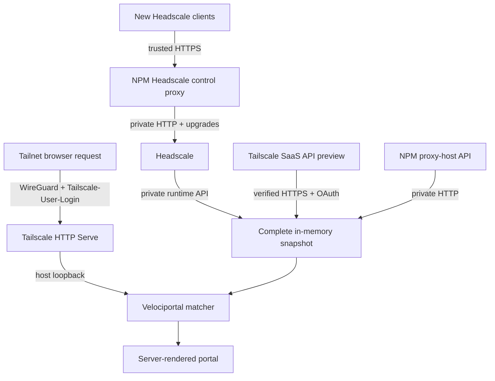

# CLAUDE.md — Velociportal

## What this project is

Velociportal is a self-hosted, identity-aware **visibility layer** for one selected control plane (Headscale or Tailscale SaaS) plus Nginx Proxy Manager (NPM). Headscale uses `legacy_acl_visibility_v1`; the Tailscale SaaS preview also accepts the narrow `network_access_visibility_v1` Grants subset and a separate bounded SSH Machines projection. Velociportal correlates supported destinations with NPM proxy hosts for service cards and, in Tailscale mode only, requires SSH-policy, Grant TCP/22, and explicit current device SSH-capability evidence for machine cards. It does not authenticate users, proxy service/SSH traffic, or enforce access; Tailscale Serve, Tailscale SSH, the selected control plane, NPM, and backend applications remain the security boundaries.

## Read before acting

1. `knowledgebase/04-handoff-context.md` — current implementation state, limitations, and next work.
2. `README.md` — concise public scope and roadmap.
3. `docs/reference/known-limitations.md` — exact current policy, matcher, identity, transport, and validation boundary.
4. `docs/guides/truenas-scale.md` — canonical TrueNAS deployment and acceptance path.
5. `docs/guides/tailscale-saas-npm.md` and `docs/reference/tailscale-api.md` — OAuth preview boundary and live acceptance requirements.
6. `docs/guides/private-tls.md` — optional native Headscale HTTPS/private-CA alternative.
7. `knowledgebase/` — stable reasoning:
   - `00-concept-source.md` — problem statement
   - `01-api-research.md` — Headscale, Tailscale SaaS, and NPM API research
   - `02-design-decisions.md` — locked decisions
   - `03-prior-art.md` — similar tools and lessons
   - `05-deep-research.md` — adversarial research report
   - `06-truenas-deployment.md` and `07-vps-options.md` — pointers to canonical public guides
8. `velociportal.portagenty.toml` — workspace/session config. Do not hand-edit unless changing the workspace layout.

## Current stage

**Published `v0.2.0-rc.17` is immutable at `ghcr.io/cybersader/velociportal@sha256:8791ff82a4c842ece9173eeb6360619d21b29d4ac7fa505d17eaa91adb300c8f`.** RC.17 adds opt-in single-file shared name/link/local-icon editing and metadata v3, plus documentation typography corrections. Its image reference was staged in the two existing TrueNAS environment files with ownership and modes preserved. After the user redeployed, checks on 2026-10-09 confirmed a healthy portal and an editor asset byte-identical to the RC.17 tag, not the exact running-container digest. The RC.18 candidate on `feat/browser-local-editor` adds strict `PORTAL_EDIT_MODE=off|browser|shared`, quiet browser-local NPM presentation editing, and an independently enabled personal tailnet catalog in bounded process RAM, without a new writable mount. RC.18 publication must be established by its successful immutable release workflow and recorded image digest; these features are not part of RC.17. Sequential contained Go build/vet/full race, production/contributor Compose and strict MkDocs checks passed. A later JS-only corrective batch passed 143 editor, 113 original personal and 10 regression checks; independent delta review confirmed both discovered defects fixed. The Go/Compose/public-docs inputs were unchanged by that corrective batch; root guidance/handoff reconciliation followed those checks. Native-browser layout/focus/touch and real two-device/restart acceptance remain pending. No shared-editor storage, personal-catalog setting or live editing configuration has been provisioned. Command targets, account validation, console roles/origin, OAuth scopes, health semantics, PWA privacy, and base deployment topology remain unchanged. Arbitrary logo uploads/external icon URLs, access history, account-synchronized personal preferences, automatic TrueNAS update/rollback, and HTTPS Serve changes remain deferred. Every published RC is immutable and must never be replaced or retagged.

NPM always uses the egress-capable private bridge `velociportal-upstreams`. Headscale mode also uses its exact private alias and preserves the existing NPM HTTPS control path plus workstation-only `headscale-ops`. Tailscale SaaS mode uses the preferred default network for fixed-origin verified HTTPS OAuth calls and does not require Headscale or the NPM Headscale control proxy. Browser ingress remains declarative Tailscale HTTP Serve to the loopback-only host port. No public support claim is justified yet. Headscale bootstrap, key separation, policy/node setup, NPM control-proxy acceptance, and the two-identity plus LAN-negative worksheet remain pending. Tailscale SaaS must remain preview until token refresh/revocation, separate owner mapping, unsupported HTTP-policy/SSH-suppression negatives, two identities, service/machine and HTTP/SSH reachability parity, copied-target checks, stale/cold recovery, header replacement, and LAN-negative tests pass. Fixture coverage, API connectivity, RC.4 Owner-role success, and a 48-service-card render are not end-to-end proof.

## Hard constraints (locked)

- **Visibility only.** No login, SSO, OIDC/SAML, session issuance, request proxying, or enforcement.
- **Single Docker container.** One static non-root binary in a minimal image, deployable on TrueNAS SCALE.
- **One selected control plane + NPM.** `CONTROL_PLANE=headscale|tailscale` selects exactly one provider. Headscale loads policy/nodes; Tailscale loads OAuth/policy/users/devices. NPM remains service discovery. There is no multi-tailnet aggregation, application database, or persisted cache.
- **Provider compatibility and labels.** Absent `CONTROL_PLANE` defaults to Headscale only through v0.2 with a value-free warning; v0.3 requires explicit selection. Headscale is `supported`; Tailscale is `preview` until live acceptance. Inactive known credentials are ignored with key-name-only warnings and must be included in redaction inputs.
- **Restricted Headscale transport.** `HEADSCALE_URL` may use HTTP only for the exact allowlisted local/internal host forms implemented by configuration validation; the canonical deployment uses `http://headscale.velociportal.internal:8080` on `velociportal-upstreams`. Every other Headscale location requires verified HTTPS. Never disable verification, follow redirects, or use environment proxies.
- **Fixed Tailscale SaaS transport.** Production uses OAuth client credentials only, exact scopes `policy_file:read`, `devices:posture_attributes:read`, `devices:core:read`, and `users:read`, fixed origin `https://api.tailscale.com/api/v2`, and the credential's `-` alias. Add no API-key/access-token fallback, configurable origin, explicit tailnet, insecure TLS, redirect, or environment-proxy behavior. Tokens stay in memory, refresh early, coalesce, and retry once after `401`; redact client IDs, secrets, and old/current tokens.
- **Named private upstream bridge.** Runtime NPM traffic and Headscale-mode control-plane traffic use the egress-capable user-defined bridge `velociportal-upstreams` with alias `npm.velociportal.internal` and, when Headscale is selected, `headscale.velociportal.internal`. TrueNAS catalog apps need that bridge to provide outbound NAT/DNS because selecting a UI-managed network replaces their implicit default network. A normal bridge does not publish container ports to the LAN. Plain HTTP for either credentialed upstream is accepted only for its exact canonical alias or same-host/loopback compatibility routes; every other location requires verified HTTPS. Headscale port `8080` is exposed only to attached containers and is never LAN-published. Keep untrusted containers off the bridge. The base Compose bundle has no CA mount.
- **NPM Headscale control proxy is explicit and mode-specific.** In Headscale mode, existing NPM terminates the trusted HTTPS endpoint used by clients and `headscale-ops`, then proxies to Headscale over the private Docker bridge with WebSocket/upgrade behavior preserved. Use split-horizon/private DNS and an existing DNS-01 wildcard certificate; do not publish the Headscale hostname/address in public DNS or disclose the exact host through a public leaf certificate. NPM is a trust and availability boundary and can observe operator Bearer API keys. Keep separate operator and Velociportal runtime keys, avoid authorization-header logging, and back up NPM configuration and certificates. Runtime Headscale-mode Velociportal bypasses the NPM control proxy. Tailscale mode needs no Headscale control proxy.
- **Read-only upstreams.** Headscale administration belongs in the separate workstation-only `headscale-ops` project, never in Velociportal. `headscale-ops` remains HTTPS-only. The user-approved shared editor may mutate only the existing local service-presentation configuration file. The independently enabled personal catalog may mutate only exact-login user-authored launch entries in bounded process RAM. Neither exception grants upstream administration, policy writes, an account/session store, or a persisted authorization cache.
- **Optional private TLS only.** Native Headscale HTTPS/private CA remains an optional alternative through the Compose CA overlay. Add no PKI service and no insecure TLS mode.
- **Tailscale identity headers only.** Trust `Tailscale-User-Login` and siblings only from `TRUSTED_PROXY_CIDR`. No direct Authentik, Authelia, `Remote-User`, or `X-Webauth-*` adapter exists.
- **Tailnet-only browser ingress.** Use the existing host-network TrueNAS Tailscale app with declarative HTTP Serve `:8081 -> http://127.0.0.1:18080`. WireGuard protects ordinary on-path LAN/router/ISP transport and Tailscale injects human identity. Endpoint and control-plane compromise remain in scope. NPM is not portal identity.
- **No public raw ports.** The Velociportal host publication remains loopback-only or equivalently private. Never expose the raw app port on the LAN. Headscale's internal API port is never LAN-published.
- **Narrow access-rule subset only.** Headscale remains legacy-ACL-only in `legacy_acl_visibility_v1`. Tailscale may combine legacy `acls` `accept` rules with safe network `grants`; non-empty accepted Grants select `network_access_visibility_v1`. Legacy ACL ports/protocols remain unmodeled. A Grant becomes HTTP service-card evidence only when one `ip` capability permits TCP to the exact NPM `forward_port`. Valid non-TCP Grants may load but produce no applicable HTTP card. Posture, non-empty `via`, application capabilities, IP sets, services, unknown HTTP fields/actions/sections, malformed capabilities, and unsafe selectors reject the complete refresh. SSH never becomes HTTP service-card evidence; the separate bounded Machines projection is governed below. `autogroup:internet` fails closed.
- **Machine Grant sources do not become humans.** Valid source tags, IPs, CIDRs, host aliases, `autogroup:tagged`, `autogroup:shared`, and other supported machine autogroups may load so machine rules do not block the snapshot, but they never match a browser identity. `tagOwners` and tags on a user's nodes do not make the user a `tag:*` source. Destination tags still resolve through node addresses.
- **Tailscale human roles are authoritative and isolated.** The complete Users API response maps each exact canonical unpadded `loginName` to Grant and bounded SSH-machine human-role selectors. A direct `type: member` user receives `autogroup:member` plus `autogroup:<role>` for `owner`, `admin`, `member`, `it-admin`, `network-admin`, `billing-admin`, or `auditor`; the Owner additionally receives `autogroup:admin`, matching Tailscale's automatic membership. A shared user receives none. Specialized roles do not imply one another. There is no trimming into membership, case folding, short/bare-login fallback, or membership inference from devices, owners, tags, or `tagOwners`. This mapping never broadens legacy ACLs or `nodeAttrs`; missing, malformed, padded, or unknown login/type/role values reject the complete refresh.
- **SSH Machines is separate, triple-evidence, and Tailscale-preview-only.** The projection is available only for Tailscale with a present, fully supported normalized SSH policy. Headscale, absent SSH, and unsupported SSH omit the entire Machines section and suppress per-identity Doctor machine previews; Doctor retains the top-level coarse unsupported-policy diagnostic. When the projection is available but an identity has zero matches, the portal preserves the explicit empty Machines state. A machine requires one supported SSH rule, one independent Grant permitting TCP/22 for the same exact direct member and device, and exact current device self-report of `sshEnabled=true` plus `blocksIncomingConnections=false`. Missing, null, malformed, false, blocked, or mismatched capability data fails closed and removes the machine; capability is never inferred from OS, name, tags, owner, or address. Legacy ACL port 22, NPM, access lists, service metadata, organization, health, and browser URLs are never machine evidence. Supported SSH sources are exact full logins, defined groups containing exact full logins, or supported human-role autogroups; destinations are tags or `autogroup:self`; actions are `accept`/`check`; users are validated literal accounts or `autogroup:nonroot`; optional `checkPeriod` is canonical and bounded from one minute through 168 hours on `check`. Projection unavailability never invalidates otherwise supported HTTP cards. Cards are non-service-link policy summaries, never enforcement/reachability/health claims, and show a short display/search name (the first label of a canonical `*.ts.net` target) alongside the full canonical target, plus truthful plain-language action text ("No extra sign-in" for `accept`; "Reauthenticate every `<period>`" for `check`, using Tailscale's documented 12-hour default when `checkPeriod` is absent) instead of raw policy tokens; only the separately bounded browser-console navigation action below may add a link. Copy commands for a validated literal account use a canonical full `*.ts.net` name or validated Tailscale CGNAT IPv4/Tailscale ULA IPv6 fallback and are built entirely server-side; arbitrary FQDNs and ordinary private addresses never become copied targets. Where `autogroup:nonroot` applies, the portal additionally offers a purely client-side, client-validated custom account text input (never pre-filled, never sent to or verified by Velociportal, and rejecting `root`) so the viewer can copy a command for a non-root account the policy permits but Velociportal cannot enumerate. Doctor exposes only coarse SSH state/reason/rule and triple-evidence machine counts, never topology/accounts/commands.
- **The browser SSH console action is role-gated navigation, not a session.** Tailscale does not expose a standalone browser-SSH session URL. Every rendered machine already requires exact device `sshEnabled=true` plus `blocksIncomingConnections=false`; the portal adds the console link only when the viewer is also a direct member holding an automatic-admin-equivalent role (Owner, Admin, IT admin, or Network admin). The link opens the fixed `https://console.tailscale.com/admin/machines?q=<validated-name-or-IP>%20property:tailscale-ssh` page in a new tab with `target=_blank rel="noopener noreferrer"`; canonical names use their validated short first label and IP fallbacks use the address. The capability fields narrow the visibility projection but remain current device self-report, not authorization, health, reachability, or proof that a browser session will succeed. Velociportal never opens or proxies a session; Tailscale remains responsible for console eligibility, reauthentication, SSH policy, device posture, account choice, and the session itself.
- **The mobile/PWA shell never caches identity-derived portal data.** Mobile renders a safe-area-aware Services/Machines/More bottom navigation outside the htmx swap region; More opens the existing account settings as a bottom sheet. Portal responses carry `Cache-Control: no-store` plus identity-header `Vary`. The manifest and committed icons support installation where the browser origin is a secure context, but the service worker has lifecycle handlers only: no fetch handler, Cache Storage, offline fallback, or cached authorization data. Full service-worker/install behavior requires HTTPS or localhost; the canonical plain-HTTP Tailscale Serve route does not provide that secure context, and changing it is a separate infrastructure decision.
- **Per-identity SSH account suggestions are browser-local and never synchronized.** Where the safe custom non-root account input applies, the portal remembers up to 10 validated account names the viewer has typed, most-recently-used first, scoped by the same opaque SHA-256 login digest used for the logo preference and stored only in that browser's `localStorage` as a datalist suggestion source; a visible control clears the saved list for that identity/browser. Velociportal never receives, stores, or synchronizes these values across identities, browsers, or devices.
- **Appearance preferences are per-identity, browser-local, and never synchronized.** A username-triggered accessible settings panel replaces the former standalone logo toggle. The one built-in-logo visibility preference is scoped by an opaque SHA-256 digest of the exact login (never the raw login) and stored only in that browser's `localStorage`; it is never sent to or stored by Velociportal. A legacy unscoped key migrates once into the scoped key. Optional strict `PORTAL_LOGO_DEFAULT=visible|hidden` supplies only the initial deployment default used when no valid browser preference exists for that identity; the per-identity browser choice always wins once set. Arbitrary per-service logos, access history, broader personalization, account-synchronized profiles, and delegated administration remain deferred.
- **Node attributes are non-authorization metadata.** Tailscale attr-only `nodeAttrs` may load only for `*`, individual users, defined groups, tags, and `autogroup:member` targets with the `funnel` attribute; they never grant cards. Non-empty `nodeAttrs.app`, malformed section types, and unknown node-attribute semantics reject the refresh.
- **Safe provider switching.** Setup prompts for the provider first and only that credential family. On a switch it lists inactive known keys and requires explicit confirmation before deleting them; refusal or input abort leaves the original file byte-for-byte unchanged. Preserve unknown keys and never create a plaintext credential backup.
- **NPM access lists are not visibility inputs.** Do not describe `access_list_id` or access-list API data as part of card authorization.
- **Service metadata is presentation-only.** For an already matched NPM host, prefer the first concrete NPM domain; a wildcard-only host remains visible but unlinked. Adding the real concrete hostname to the same NPM proxy host is preferred over metadata, and a duplicate NPM host may duplicate the card. Strict optional metadata v1 may override display name/browser URL; v2 may additionally assign category/order by existing positive proxy-host ID after policy matching; v3 adds finite embedded local icon IDs to that same document. Categories group only already-authorized cards, uncategorized cards remain last, and explicit order applies only within a category before deterministic name/ID fallbacks. Metadata cannot create/hide/enable cards, repair a domainless host, change `forward_host`/`forward_port`, alter health, or grant visibility. The browser-local logo preference remains unchanged; the separately selected browser editor may also override service name/link/finite embedded icon. Arbitrary logo uploads/external icon URLs, access history, and server-side/account-synchronized personal preferences remain deferred. The base stack stays mount-free; the opt-in read-only overlay uses a fixed target and supplemental numeric group so TrueNAS `950:950`, directory `0750`, and file `0640` remain unchanged. `meta.nginx_online` is NPM route state, never backend health.
- **Service edit mode is deployment-selected.** Strict `PORTAL_EDIT_MODE=off|browser|shared` selects the mode, not a dashboard switch. Absence preserves RC.17 shared-setting inference and validation; explicit `off` ignores retained shared-editor settings without initializing a writer. `browser` rejects supplied `PORTAL_EDITORS`/`PORTAL_PUBLIC_ORIGIN`, needs no file/allowlist/origin/writable mount, initializes no shared writer/lock/edit API, and makes no edit API requests. `shared` retains the existing storage and identity guards. Empty or noncanonical modes fail configuration.
- **Browser service editing is personal and non-authorizing.** Only bounded user-entered name/HTTP(S)-URL/finite-icon overrides are stored in a versioned browser-local map keyed by positive service ID, scoped by the exact-login opaque digest and browser origin. Validate untrusted data on load and save; guard storage failures and never report a failed save as persisted. Overrides apply only to current authorized DOM cards, never create or restore missing cards, and never change categories/order/health/SSH. Blank/reset restores current server defaults, including optional read-only metadata. Polling applies fresh defaults before overrides and search; identity/mode/access loss invalidates editing. No raw login, tokens, catalog, policy or authorization cache is stored. No synchronization; clearing site storage removes preferences. Keep the existing Edit/Save/Reset UI quiet, with “Saved in this browser” help rather than a prominent mode badge. Existing logo and SSH-account preferences remain unchanged.
- **Shared service editing is optional and single-file.** `PORTAL_EDITORS` is an explicit exact-login allowlist; `PORTAL_PUBLIC_ORIGIN` fixes the browser origin. Editing is off by default and requires both settings plus an existing valid `SERVICE_METADATA_FILE` in a separately provisioned runtime-owned writable directory. Only currently visible services may be edited, with trusted-proxy identity, origin/CSRF/input checks and whole-file conflict detection. Explicit saves preserve unrelated entries and category/order while serializing v3; reset removes only name/link/icon overrides. No second presentation store, arbitrary uploads, remote logo service, or new cards. Atomic writes and a lifetime lock require the alternative directory mount, not the read-only file overlay. Do not loosen the protected TrueNAS config directory or provision live storage without the user's separate approval. External edits require stop/edit/restart. An uncertain post-rename save disables further writes pending reconciliation; rollback to a v1/v2-only release requires compatible metadata and editing-disabled configuration, not merely an older image. See `docs/reference/service-metadata.md`.
- **Personal tailnet services are optional, personal and volatile.** Tailscale-only `PORTAL_PERSONAL_SERVICES_ORIGIN` independently enables a same-portal canonical-origin API and controls; absence disables them and supplied empty/invalid values or Headscale fail configuration. Store only the exact trusted login's authored name/canonical HTTPS current-device `*.ts.net` launch URL/finite-icon records in bounded RAM: at most 128 initialized collections, including empty ones, each 128 entries/64 KiB. Personal IDs are separate from positive NPM IDs and never join NPM metadata, health or editor routes. Active links require a fresh complete snapshot, unique current hostname resolution, authoritative direct-member identity and a positive network Grant permitting TCP to the URL ingress port; legacy ACLs and SSH evidence do not suffice. Hostname reuse follows the current replacement device. No arbitrary domains, IP fallback, query, fragment, userinfo or pairing links; path-embedded secrets cannot be reliably detected. Inactive authored records remain manageable without bypass links. Trusted identity, exact Host/Origin, strict input/CSRF/body/concurrency bounds and atomic generation/revision CAS protect mutations. Existing polling shares acknowledged RAM state across devices without another browser online. Restart/redeploy loses RAM; validated opaque-login/origin-scoped browser copies contain authored records/version/generation/revision only, never tokens, policy or access decisions. Restoration/adoption is explicit and may be stale; initialized-empty deletion must not resurrect records. Preserve conflicting drafts, refresh aging CSRF before mutation without silently changing CAS, and reconcile uncertain saves without replay. Cross-tab recovery repair offers eventual convergence when storage/events work, not atomic writes or crash durability. No new mount, database, container, upstream write, offline queue, auto-merge, iroh, MCP or live provisioning is authorized. Existing NPM dependencies, freshness behavior, `/healthz`, SSH and browser-only preferences remain unchanged. See `docs/reference/service-metadata.md`.
- **Hostname suggestions are one-shot and non-authorizing.** `suggest-hostnames` may use only names already returned by the selected provider plus optional bounded hostname-only stdin. Canonical ASCII FQDNs must match exact wildcard suffixes on label boundaries; only one-hostname/one-NPM-ID graph components may produce a strict metadata-v1 proposal. Require private review, explicit browser scheme, and literal confirmation. Add no DNS/log scan, runtime store, portal route, automatic active-metadata mutation, new scope/endpoint, production mount, or tie-breaker for ambiguity.
- **Service health is explicit, bounded, and non-authorizing.** Only positive proxy-host IDs in a strict optional health file are probed. Targets derive solely from current enabled NPM backend fields after a supported identity-independent structural destination match; presentation URLs never become targets. HTTP is credential-free `GET`, TCP connects and closes without payload, DNS names require exact host/suffix plus all-answer CIDR validation, and validated IPs are dialed directly with verified TLS, no redirects/proxies, hard-denied address classes, and protected NPM/control-plane API sockets. A fixed worker pool publishes memory-only coarse results independently of the complete authorization/catalog snapshot. Health never creates, hides, enables, reorders, or authorizes a card and never affects `/healthz`.
- **Router resilience.** No CA or application state belongs on pfSense/the router. Router replacement restores ordinary DNS and routing only; durable app, network, NPM, Headscale, and policy state stays on TrueNAS and backups.
- **Simple over clever.** Go standard library, embedded server-rendered HTML, embedded htmx, two upstream clients, and a polling goroutine. Add dependencies only when necessary.
- **No AI attribution in commits.** Never add Claude, Anthropic, or another AI system as co-author or contributor.

## Architecture sketch

A refresh is all-or-nothing: the complete selected-provider result and NPM proxy hosts must all succeed before replacing the snapshot. A failed refresh keeps the previous in-process snapshot; a restart starts cold. `/healthz` is healthy only when a recent complete snapshot exists.

## Required verification discipline

- Run heavy verification **sequentially and contained** because this host has previously experienced PSI pressure. Do not launch broad test/build/container work in parallel.
- Run `go test -race -count=1 ./...` for Go changes when heavy verification is authorized.
- Run `ENV_FILE=.env.example docker compose -f docker-compose.yml --profile tools config --quiet` for contributor Compose changes. Production Compose verification must render both provider env examples, short-form includes, and optional CA overlays without changing the one-service/two-network contract.
- Run a strict MkDocs build for documentation changes when heavy verification is authorized.
- Do not claim real integration validation until the canonical TrueNAS path has been exercised with at least two identities, LAN-negative tests, NPM control-proxy checks, and card sets compared with actual selected-control-plane reachability. Tailscale additionally requires live OAuth refresh/revocation, authoritative exact canonical-login role mapping with padded-login rejection, Owner-to-Admin automatic membership, direct-member/shared-user and specialized-role isolation cases, separate device-owner mapping, role-derived Grant evidence, unsupported-policy negatives, supported/unsupported SSH cases, dual SSH-plus-Grant TCP/22 machine evidence, copied-target parity, and actual Tailscale SSH outcomes before preview can become supported.
